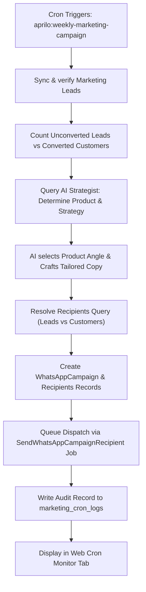

# Aprilo Infotech — Marketing & Campaigns Suite

A comprehensive product marketing, campaign automation, and customer conversion suite built for **Aprilo Infotech** (a technology brand of **APRILO ENTERPRISES**).

---

## 1. Feature Overview

The **Marketing & Campaigns Suite** brings together WhatsApp outreach, AI-powered copywriting, lead lifecycle segmentation, campaign resending, and automated weekly cron scheduling with full audit monitoring.

### Key Capabilities
- **Resend Campaigns**: One-click campaign resending with targeted filters:
  - *Failed recipients only* (bounce/delivery failure recovery)
  - *Unconverted leads only* (follow-up nudge for prospects)
  - *All recipients* (re-engagement)
  - Optional copy refinement before dispatch.
- **Rich Product Campaigns**: Specialized value propositions, benefits, and call-to-action hooks for all core Aprilo software products:
  - **Aprilo POS** (Retail billing, barcode scanning, inventory sync)
  - **Aprilo Chatbot** (24/7 AI WhatsApp customer support & lead capture)
  - **Aprilo Agent** (Autonomous multi-channel AI business operator)
  - **Aprilo Commerce** (Multi-store catalog & order sync engine)
  - **TradeFlow** (B2B wholesale, dealer margins & supply chain ERP)
- **AI Campaign Copywriter (`CampaignAiService`)**:
  - Automatically drafts tailored WhatsApp and Email copy based on audience segment, product focus, and campaign goal.
  - Interactive "✨ Write Campaign with AI" modal with 1-click form auto-fill.
  - Supports dynamic merge variables: `{customer_name}`, `{company_name}`, `{product_name}`.
- **Lead & Customer Pipeline**:
  - Track contacts with explicit conversion statuses: `lead` (unconverted prospect), `converted` (paying customer), and `lost`.
  - **Unconverted Leads** receive problem-solving, objection handling, and demo/discount offers.
  - **Converted Customers** receive complementary product announcements and VIP cross-sells.
  - Instant 1-click status toggle directly from the management console.
- **Automated Weekly Campaign via Cron (`aprilo:weekly-marketing-campaign`)**:
  - Automatically queries the AI strategist prior to dispatch to evaluate live database metrics.
  - Formulates today's optimal product angle and writes custom personalized copy.
  - Dispatches to the appropriate segment and records full audit logs.
- **Cron Monitor Console**:
  - Dedicated web console tab displaying scheduler status, execution history, duration, and AI strategy logs.
  - Includes a **"▶ Run Automated Campaign Now (Test/Trigger)"** button for immediate on-demand execution.

---

## 2. Architecture & Database Design

### Migrations
File: `database/migrations/2026_11_08_000001_create_marketing_and_campaign_resend_tables.php`

1. **`marketing_leads` Table**:
   - `id` (UUID Primary Key)
   - `organization_id` (Nullable Foreign UUID to `organizations`)
   - `name` (Contact Name)
   - `phone` (E.164 normalized phone number, indexed)
   - `email` (Contact email address, indexed)
   - `company_name` (Business entity)
   - `status` (`lead` [unconverted], `converted` [paying customer], `lost`)
   - `target_product` (`Aprilo POS`, `Aprilo Chatbot`, `Aprilo Agent`, `Aprilo Commerce`, `TradeFlow`)
   - `preferred_channel` (`whatsapp`, `email`, `both`)
   - `last_contacted_at` (Timestamp)
   - `last_campaign_name` (String)
   - `conversion_notes` (Text for sales context)
   - `tags` & `metadata` (JSON)

2. **`marketing_cron_logs` Table**:
   - `id` (UUID Primary Key)
   - `command_name` (`aprilo:weekly-marketing-campaign`)
   - `status` (`success`, `skipped`, `failed`)
   - `target_product` (e.g. `Aprilo POS`)
   - `segment_targeted` (`unconverted_leads`, `converted_customers`, `all`)
   - `recipients_count`, `accepted_count`, `failed_count`
   - `campaign_id` (Foreign UUID to `whatsapp_campaigns`)
   - `ai_strategy_summary` (AI justification for selected strategy)
   - `ai_generated_copy` (Full generated text)
   - `execution_time_seconds` (Float execution duration)
   - `executed_at` (Timestamp)

3. **`whatsapp_campaigns` Extensions**:
   - `target_product` (Product name)
   - `audience_segment` (`all`, `leads`, `converted`, `manual`)
   - `resend_count` (Counter)
   - `last_resent_at` (Timestamp)
   - `parent_campaign_id` (Self-referencing Foreign UUID for tracking resends)
   - `ai_generated` (Boolean)
   - `ai_prompt_notes` (Text)
   - `is_automated` (Boolean)

4. **`whatsapp_campaign_recipients` Extensions**:
   - `lead_id` (Foreign UUID to `marketing_leads`)
   - `resend_attempt` (Integer attempt counter)
   - `last_attempted_at` (Timestamp)

---

## 3. Product Catalog & Value Propositions

| Product | Target Audience | Primary Value Proposition |
| :--- | :--- | :--- |
| **Aprilo POS** | Retail stores, supermarkets, boutiques | Lightning-fast barcode checkout, real-time stock sync, offline billing, GST & commercial invoices. |
| **Aprilo Chatbot** | E-commerce, service companies, local businesses | 24/7 automated WhatsApp customer engagement, product catalog answers, instant lead qualification. |
| **Aprilo Agent** | Growing enterprises, SaaS platforms | Autonomous multi-channel AI operator for ticketing, SLA resolution, webhook workflows, and CRM routing. |
| **Aprilo Commerce** | Multi-store merchants (Shopify, Magento) | Two-way catalog & order sync, plugin licensing engine, semantic AI search embeddings, zero inventory mismatch. |
| **TradeFlow** | Wholesale distributors, B2B traders, supply chains | Bulk dealer dispatch, vendor margin calculator, batch & expiry tracking, GST credit note ledger reconciliation. |

---

## 4. Audience Segmentation & Messaging Strategy

### 1. Unconverted Leads (`status = 'lead'`)
- **Objective**: Overcome hesitation, address manual friction, build trust, and offer a low-friction action (free demo walkthrough or limited-time onboarding incentive).
- **Tone**: Empathetic, solution-oriented, clear ROI.
- **Default Hook**:
  > *"Hi {customer_name}, still managing manual billing bottlenecks? See how Aprilo POS cuts checkout time in half."*
- **Call-to-Action**: *"Reply 'DEMO' to schedule a 5-minute live walkthrough."*

### 2. Converted Customers (`status = 'converted'`)
- **Objective**: Deepen partnership, announce product innovations, and cross-sell complementary software products.
- **Tone**: Exclusive, VIP, collaborative.
- **Default Hook**:
  > *"Dear {customer_name}, as a valued Aprilo user, we're excited to introduce TradeFlow to seamlessly connect with your existing setup."*
- **Call-to-Action**: *"Reply 'INFO' for priority customer onboarding & VIP upgrade pricing."*

---

## 5. Resend Campaign Workflow

When viewing the **Campaign History** table:
1. Click the **"🔁 Resend"** button next to any campaign.
2. Select your target:
   - **Failed recipients only**: Automatically identifies recipients with `status = 'failed'` for instant bounce recovery.
   - **Unconverted leads only**: Re-targets prospects who are still marked as `lead`.
   - **All original recipients**: Re-dispatches to the entire audience.
3. (Optional) Adjust the message copy in the text area.
4. Click **"Dispatch Resend Campaign"**:
   - Clones the campaign as `{Campaign Name} [Resend #X]`.
   - Sets `parent_campaign_id` to maintain parent-child linkage.
   - Increments parent's `resend_count` and updates `last_resent_at`.
   - Increments `resend_attempt` on each recipient record.

---

## 6. AI Campaign Copywriter Engine

The service `App\Services\AI\CampaignAiService` powers copy generation:
- Can be triggered manually via the UI button: **"✨ Write Campaign with AI"**.
- Queries Google Gemini API (with resilient intelligent fallback) to generate persuasive marketing text, dynamic hooks, bullet points, and sign-offs.
- Injects standard Aprilo Infotech branding:
  ```text
  Aprilo Infotech
  Build Smarter. Grow Faster.
  https://apriloinfotech.com
  ```

### API Endpoint:
- **Route**: `POST /admin/super/marketing/ai-generate`
- **Payload**:
  ```json
  {
    "product_name": "Aprilo POS",
    "target_audience": "unconverted_leads",
    "campaign_goal": "lead_followup",
    "discount_code": "APRILO20",
    "custom_notes": "Highlight GST invoice and barcode printing"
  }
  ```
- **Response**:
  ```json
  {
    "status": "success",
    "data": {
      "campaign_name": "Aprilo POS — Lead Followup Nudge",
      "whatsapp_headline": "Stop losing revenue to slow manual billing...",
      "whatsapp_message": "Hi *{customer_name}* 👋\n\nAre manual inventory mismatches slowing your store down?...",
      "call_to_action": "Reply 'DEMO' to schedule walkthrough",
      "strategy_notes": "Lead Follow-up: Addresses core friction..."
    }
  }
  ```

---

## 7. Weekly Automated Cron Command

### Command Specification
- **Signature**: `php artisan aprilo:weekly-marketing-campaign`
- **Options**:
  - `--force`: Force immediate execution regardless of day.
  - `--segment=auto|leads|converted|all`: Target segment override.
  - `--product="Aprilo POS"`: Product override.

### Scheduler Definition
In `routes/console.php`:
```php
use Illuminate\Support\Facades\Schedule;

Schedule::command('aprilo:weekly-marketing-campaign')
    ->weeklyOn(1, '09:00') // Every Monday at 09:00 IST
    ->withoutOverlapping()
    ->runInBackground();
```

### Automation Logic Flow


---

## 8. Web Console UI & Navigation

Accessible via the main Admin sidebar:
**Platform Administration ➔ Marketing & Campaigns** (`/admin/super/whatsapp-campaigns`)

### Tabs:
1. **WhatsApp Campaigns & Outreach**:
   - Campaign creation form (Product selector, Delivery mode, Recipient mode).
   - "✨ Write Campaign with AI" modal.
   - Campaign History table with "🔁 Resend" modal.
   - Recipient Delivery Audit Log.
2. **Leads & Customer Pipeline**:
   - Metric cards (Total Contacts, Unconverted Leads, Converted Customers, Lost).
   - "+ Add Lead / Customer" modal.
   - Instant 1-click status switcher (`[Mark Converted]` ⇄ `[Set Lead]`).
   - Filter by status (`?lead_status=lead` / `?lead_status=converted`).
3. **Weekly AI Automation & Cron Monitor**:
   - Scheduler details and pre-flight logic breakdown.
   - **"▶ Run Automated Campaign Now"** button for on-demand test runs.
   - Execution audit history table with AI strategy notes and expandable generated copy.

---

## 9. Meta WhatsApp Cloud API Production Setup

To enable live message delivery:
1. Set the following keys in your `.env` file:
   ```dotenv
   WHATSAPP_PHONE_NUMBER_ID=your_meta_phone_number_id
   WHATSAPP_ACCESS_TOKEN=your_meta_system_user_permanent_token
   WHATSAPP_BUSINESS_ACCOUNT_ID=your_waba_id
   ```
2. **Templates vs Freeform Messages**:
   - Outside of a 24-hour customer conversation window, Meta requires **Approved WhatsApp Templates**.
   - Within an active 24-hour service window (or test numbers), freeform text copy generated by the AI Copywriter is accepted.
3. **Opt-in Compliance**:
   - Ensure all imported leads and customer contacts have given explicit permission to receive WhatsApp business updates.

---

© 2026 **APRILO ENTERPRISES** · Trading as **APRILO INFOTECH**
*Build Smarter. Grow Faster.*

